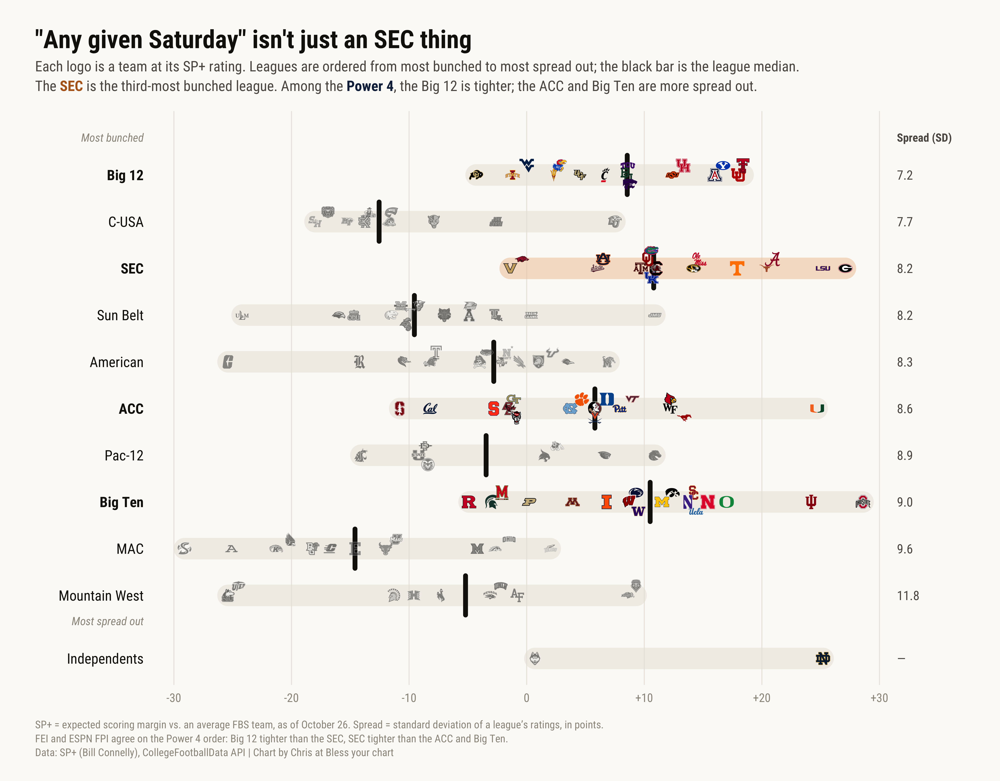
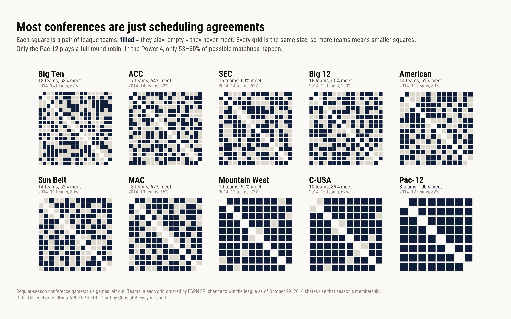

### Shared setup

```{r setup, warning=FALSE, message=FALSE}
paper <- "#FBFAF7"
ink <- "#16130F"
muted <- "#5C574F"
faint <- "#9C968C"
navy <- "#13294B"
orange <- "#B5651D"

p4 <- c("SEC", "Big Ten", "Big 12", "ACC")
g6 <- c("American Athletic", "Sun Belt", "Mid-American", "Mountain West", "Conference USA", "Pac-12")
fbs_confs <- c(p4, g6)
conf_short <- c(
  "SEC" = "SEC", "Big Ten" = "Big Ten", "Big 12" = "Big 12", "ACC" = "ACC",
  "American Athletic" = "American", "Sun Belt" = "Sun Belt", "Mid-American" = "MAC",
  "Mountain West" = "Mountain West", "Conference USA" = "C-USA", "Pac-12" = "Pac-12"
)

logo_url <- \(id) paste0("https://a.espncdn.com/i/teamlogos/ncaa/500/", id, ".png")
pct3 <- \(x) sub("^0", "", formatC(x, format = "f", digits = 3))
fmt_line <- \(x) sub("\\.0$", "", formatC(x, format = "f", digits = 1))

# Roboto Condensed on the macOS quartz device. The installed font is a
# variable font, which ragg draws at one weight, so ggplots are saved with
# grDevices::png(type = "quartz") to get real bold and italic faces.
grDevices::quartzFonts(rc = c(
  "RobotoCondensed-Regular", "RobotoCondensed-Bold",
  "RobotoCondensed-Italic", "RobotoCondensed-BoldItalic"
))
rc <- "rc"

theme_byc <- function() {
  ggplot2::theme_void(base_family = rc) +
    ggplot2::theme(
      plot.title = ggplot2::element_text(family = rc, face = "bold", size = 20, color = ink, margin = ggplot2::margin(0, 0, 6, 0)),
      plot.subtitle = ggtext::element_textbox_simple(family = rc, size = 11.5, color = muted, lineheight = 1.35, margin = ggplot2::margin(0, 0, 14, 0)),
      plot.caption = ggtext::element_textbox_simple(family = rc, size = 8.5, color = faint, lineheight = 1.3, margin = ggplot2::margin(14, 0, 0, 0)),
      plot.background = ggplot2::element_rect(fill = paper, color = NA),
      plot.margin = ggplot2::margin(24, 28, 18, 28)
    )
}
```

### Logo strip: how bunched is each league?

One row per league, one logo per team at its SP+ rating. Leagues are ordered by the standard deviation of their teams' ratings, so the most bunched league is on top. Logos are placed beeswarm-style: each one takes the nearest open slot above or below the line.

```{r parity-strip, warning=FALSE, message=FALSE}
sp <- readr::read_csv("sp_plus_2026_10_26.csv", show_col_types = FALSE)
sp_date <- as.Date(sp$sp_date[1])

teams <- sp |>
  dplyr::transmute(team, id, conf = conference, rating = sp_plus) |>
  dplyr::mutate(indie = conf == "FBS Independents")

# Leagues ranked by spread; the two independents go last, unranked.
spread <- teams |>
  dplyr::summarise(sd = stats::sd(rating), med = stats::median(rating), lo = min(rating), hi = max(rating), .by = c(conf, indie)) |>
  dplyr::arrange(indie, sd) |>
  dplyr::mutate(
    row = dplyr::row_number() + indie * 0.35,
    label = dplyr::if_else(indie, "Independents", conf_short[conf]),
    p4 = conf %in% p4,
    sd_txt = dplyr::if_else(indie, "—", sprintf("%.1f", sd))
  )

x_range <- diff(range(teams$rating))

# Each logo, left to right, takes the slot nearest the line where no placed
# logo sits within min_dx.
swarm_offsets <- function(x, min_dx = 0.022 * x_range, slots = c(0, -0.2, 0.2, -0.38, 0.38)) {
  off <- numeric(length(x))
  placed_x <- numeric()
  placed_off <- numeric()
  for (i in order(x)) {
    for (sl in slots) {
      if (!any(abs(placed_x - x[i]) < min_dx & abs(placed_off - sl) < 0.14)) break
    }
    off[i] <- sl
    placed_x <- c(placed_x, x[i])
    placed_off <- c(placed_off, sl)
  }
  off
}

teams <- teams |>
  dplyr::left_join(dplyr::select(spread, conf, row, p4), by = dplyr::join_by(conf), multiple = "error") |>
  dplyr::mutate(y = row + swarm_offsets(rating), .by = conf) |>
  dplyr::mutate(p4 = p4 | team == "Notre Dame", logo = logo_url(id))

ordinal <- c("", "second", "third", "fourth", "fifth", "sixth")
sec_rank <- which(spread$conf == "SEC")
p4_order <- spread |> dplyr::filter(p4) |> dplyr::pull(label)
x_lab <- min(teams$rating) - 0.06 * x_range
x_sd <- max(teams$rating) + 0.05 * x_range

strip <- ggplot2::ggplot() +
  ggplot2::geom_segment(
    data = spread, ggplot2::aes(x = lo, xend = hi, y = row, yend = row, color = conf == "SEC"),
    linewidth = 8, lineend = "round", alpha = 0.55
  ) +
  ggplot2::scale_color_manual(values = c(`TRUE` = "#F0C9A8", `FALSE` = "#E9E4DB"), guide = "none") +
  ggplot2::geom_segment(
    data = dplyr::filter(spread, !indie), ggplot2::aes(x = med, xend = med, y = row - 0.42, yend = row + 0.42),
    color = ink, linewidth = 1.8, lineend = "round"
  ) +
  cfbplotR::geom_from_path(
    data = dplyr::filter(teams, !p4), ggplot2::aes(x = rating, y = y, path = logo),
    width = 0.016, colour = "b/w", alpha = 0.55
  ) +
  cfbplotR::geom_from_path(
    data = dplyr::filter(teams, p4), ggplot2::aes(x = rating, y = y, path = logo), width = 0.017
  ) +
  ggplot2::geom_text(
    data = spread, ggplot2::aes(x = x_lab, y = row, label = label, fontface = ifelse(p4, "bold", "plain")),
    hjust = 1, family = rc, size = 4, color = ink
  ) +
  ggplot2::geom_text(
    data = spread, ggplot2::aes(x = x_sd, y = row, label = sd_txt),
    hjust = 0, family = rc, size = 3.6, color = muted
  ) +
  ggplot2::annotate("text", x = x_sd, y = 0.2, label = "Spread (SD)", hjust = 0, family = rc, fontface = "bold", size = 3.2, color = muted) +
  ggplot2::annotate("text", x = x_lab, y = 0.2, label = "Most bunched", hjust = 1, family = rc, fontface = "italic", size = 3.2, color = faint) +
  ggplot2::annotate("text", x = x_lab, y = max(spread$row[!spread$indie]) + 0.55, label = "Most spread out", hjust = 1,
                    family = rc, fontface = "italic", size = 3.2, color = faint) +
  ggplot2::scale_y_reverse() +
  ggplot2::scale_x_continuous(
    breaks = seq(-30, 30, 10), labels = \(x) dplyr::if_else(x > 0, paste0("+", x), as.character(x)),
    expand = ggplot2::expansion(add = c(0.16 * x_range, 0.1 * x_range))
  ) +
  ggplot2::coord_cartesian(clip = "off") +
  ggplot2::labs(
    title = "\"Any given Saturday\" isn't just an SEC thing",
    subtitle = glue::glue(
      "Each logo is a team at its SP+ rating. Leagues are ordered from most bunched to most spread out; ",
      "the black bar is the league median.<br>",
      "The <b style='color:{orange}'>SEC</b> is the {ordinal[sec_rank]}-most bunched league. ",
      "Among the <b style='color:{navy}'>Power 4</b>, the {p4_order[1]} is tighter; the {knitr::combine_words(p4_order[3:4])} are more spread out."
    ),
    caption = glue::glue(
      "SP+ = expected scoring margin vs. an average FBS team, as of {format(sp_date, '%B')} {as.integer(format(sp_date, '%d'))}. ",
      "Spread = standard deviation of a league's ratings, in points.<br>",
      "FEI and ESPN FPI agree on the Power 4 order: Big 12 tighter than the SEC, SEC tighter than the ACC and Big Ten.<br>",
      "Data: SP+ (Bill Connelly), CollegeFootballData API | Chart by Chris at Bless your chart"
    )
  ) +
  theme_byc() +
  ggplot2::theme(
    axis.text.x = ggplot2::element_text(family = rc, size = 9.5, color = faint, margin = ggplot2::margin(6, 0, 0, 0)),
    panel.grid.major.x = ggplot2::element_line(color = "#ECE8E1", linewidth = 0.4)
  )

ggplot2::ggsave("parity_strip_2026.png", strip, width = 11, height = 8.6, dpi = 500, device = grDevices::png, type = "quartz", bg = paper)

```

### GT table: Double-digit underdogs in Power 4 conference play

Every Power 4 conference game in weeks 1–8 with a line. An underdog is the team getting points. The trend strip in the header is plain HTML bars, one per season, with wins and games beneath.

```{r dd-dogs-table, warning=FALSE, message=FALSE}
season <- 2026L
min_line <- 10

lines <- readr::read_csv("p4_conf_lines_wk1_8_2014_2026.csv", show_col_types = FALSE) |>
  dplyr::mutate(
    line = abs(home_spread),
    dog_won = dplyr::if_else(home_spread < 0, away_points > home_points, home_points > away_points)
  )
last_week <- max(lines$week[lines$season == season])

trend <- lines |>
  dplyr::filter(line >= min_line) |>
  dplyr::summarise(games = dplyr::n(), wins = sum(dog_won), rate = wins / games, .by = season) |>
  dplyr::arrange(season)
base <- dplyr::filter(trend, season != .env$season, season != 2020L)
base_rate <- sum(base$wins) / sum(base$games)
cur <- dplyr::filter(trend, season == .env$season)

# Consecutive seasons the rate has risen (2020 left out)
streak <- trend |> dplyr::filter(season != 2020L) |> dplyr::arrange(dplyr::desc(season))
rising <- sum(cumprod(c(TRUE, utils::head(streak$rate, -1) > utils::tail(streak$rate, -1)))) - 1L

bar_max <- max(0.18, max(trend$rate) * 1.05)
this_season <- season
trend_strip <- paste0(
  "<div style='display:flex;align-items:flex-end;justify-content:center;gap:9px;height:92px;margin-top:10px;'>",
  paste(purrr::pmap_chr(trend, \(season, games, wins, rate) {
    is_now <- season == this_season
    h <- round(rate / bar_max * 52)
    col <- if (is_now) navy else if (season == 2020L) "#E3DED5" else "#C9C3B8"
    glue::glue(
      "<div style='display:flex;flex-direction:column;align-items:center;width:34px;'>",
      "<span style='font-size:9.5px;font-style:normal;color:{if (is_now) navy else faint};font-weight:{if (is_now) 700 else 400};'>{pct3(rate)}</span>",
      "<span style='display:block;width:20px;height:{h}px;background:{col};margin-top:2px;'></span>",
      "<span style='font-size:9.5px;font-style:normal;color:{if (is_now) navy else muted};margin-top:3px;'>'{season %% 100}</span>",
      "<span style='font-size:9px;font-style:normal;color:{if (is_now) navy else faint};font-weight:{if (is_now) 700 else 400};'>{wins}/{games}</span></div>"
    )
  }), collapse = ""),
  "</div>"
)

team_cell <- \(id, team) glue::glue(
  "<div style='display:flex;align-items:center;gap:8px;'>",
  "",
  "<div style='font-weight:600;line-height:1.1;'>{team}</div></div>"
)

wins <- lines |>
  dplyr::filter(season == .env$season, line >= min_line, dog_won) |>
  dplyr::mutate(
    home_won = home_points > away_points,
    winner = dplyr::if_else(home_won, home, away), winner_id = dplyr::if_else(home_won, home_id, away_id),
    loser = dplyr::if_else(home_won, away, home), loser_id = dplyr::if_else(home_won, away_id, home_id),
    site = dplyr::if_else(home_won, "vs.", "at"),
    score = paste0(pmax(home_points, away_points), "–", pmin(home_points, away_points)),
    line_txt = paste0("+", fmt_line(line))
  ) |>
  dplyr::mutate(n_conf_wins = dplyr::n(), .by = home_conf) |>
  dplyr::mutate(
    group = glue::glue("{home_conf} · {n_conf_wins} win{dplyr::if_else(n_conf_wins == 1, '', 's')}"),
    winner_html = team_cell(winner_id, winner),
    loser_html = team_cell(loser_id, loser),
    score_html = glue::glue("<span style='font-weight:700;'>{score}</span><div style='font-size:11px;color:{muted};'>{site}</div>")
  )

# Leagues with the most wins first, biggest line first within each
group_order <- wins |>
  dplyr::distinct(group, home_conf, n_conf_wins) |>
  dplyr::arrange(dplyr::desc(n_conf_wins), match(home_conf, p4)) |>
  dplyr::pull(group) |>
  unique()

dd_tbl <- wins |>
  dplyr::mutate(group = factor(group, group_order)) |>
  dplyr::arrange(group, dplyr::desc(line), week) |>
  dplyr::select(group, line_txt, winner_html, score_html, loser_html, week) |>
  gt::gt(id = "dd_dogs", groupname_col = "group") |>
  gtUtils::gt_theme_broadsheet(accent = navy, density = "compact") |>
  gt::tab_header(
    title = gt::html("More and more double-digit underdogs are<br>winning outright in Power 4 conference play this season"),
    subtitle = gt::html(paste0(
      glue::glue(
        "Through week {last_week}, double-digit underdogs are {cur$wins} of {cur$games} ({pct3(cur$rate)}) in Power 4 conference games.<br>",
        "That's the best rate of the playoff era (average: {pct3(base_rate)})",
        "{if (rising >= 2) paste0(', up ', rising, ' straight seasons') else ''}."
      ),
      trend_strip,
      "<div style='text-align:center;font-size:10.5px;font-style:normal;color:", faint, ";margin-top:4px;'>",
      "Double-digit underdog win rate and wins/games, weeks 1–", last_week, " of each season</div>"
    ))
  ) |>
  gt::fmt(c(winner_html, score_html, loser_html), fns = \(x) purrr::map(x, gt::html)) |>
  gt::cols_label(line_txt = "Line", winner_html = "Underdog", score_html = "Score", loser_html = "Favorite", week = "Week") |>
  gt::cols_align("center", c(line_txt, score_html, week)) |>
  gt::cols_align("left", c(winner_html, loser_html)) |>
  gt::cols_width(
    line_txt ~ gt::px(70), winner_html ~ gt::px(190), score_html ~ gt::px(80),
    loser_html ~ gt::px(190), week ~ gt::px(60)
  ) |>
  gt::tab_style(style = gt::cell_text(weight = 700, color = navy), locations = gt::cells_body(columns = line_txt)) |>
  gt::tab_source_note(gt::html(glue::glue(
    "<div style='margin-bottom:6px;'>Line = closing spread averaged across every book CFBD lists, rounded to the nearest half point. ",
    "Conference games between two SEC, Big Ten, Big 12 or ACC teams. Playoff-era rate is 2014–25 without 2020.</div>",
    "<hr style='border:none;border-top:1px solid #DEDAD2;margin:4px 0 8px 0;'>",
    "Data: CollegeFootballData API | Table by Chris at Bless your chart"
  ))) |>
  gtUtils::gt_border_bars_bottom(c("#13294B", "#56A0D3", "#BBD9ED"))

gtUtils::gt_save_crop(dd_tbl, file = "dd_dogs_p4conf_2026_wk8.png", whitespace = 40, bg = paper)

dd_tbl
```

### Schedule grids: every FBS league

Each grid is a league: every team down the side and across the top. A filled square means the two teams play in the regular season. Every grid is drawn in the same-size box, so a league with more teams gets smaller squares.

```{r schedule-grids, warning=FALSE, message=FALSE}
sched <- readr::read_csv("conf_schedules_2014_2026.csv", show_col_types = FALSE)
fpi <- readr::read_csv("fpi_title_odds_2026.csv", show_col_types = FALSE)
fpi_date <- as.Date(fpi$fpi_date[1])
then <- 2014L

# Ordered pairs of league members: do they play?
grid_data <- function(year, conf, order) {
  games <- dplyr::filter(sched, season == year, .data$conf == .env$conf)
  played <- dplyr::bind_rows(
    dplyr::transmute(games, a = home, b = away),
    dplyr::transmute(games, a = away, b = home)
  ) |>
    dplyr::distinct() |>
    dplyr::mutate(meet = TRUE)
  tidyr::expand_grid(row = order, col = order) |>
    dplyr::mutate(x = match(col, order), y = match(row, order), self = row == col) |>
    dplyr::left_join(played, by = dplyr::join_by(row == a, col == b), multiple = "error") |>
    dplyr::mutate(meet = dplyr::coalesce(meet, FALSE))
}

members <- function(year, conf) {
  g <- dplyr::filter(sched, season == year, .data$conf == .env$conf)
  dplyr::bind_rows(dplyr::distinct(g, team = home, id = home_id), dplyr::distinct(g, team = away, id = away_id)) |>
    dplyr::distinct(team, .keep_all = TRUE)
}

# 2026 teams ordered by FPI title odds (then rating); contenders top-left
order_now <- function(conf) {
  m <- members(season, conf) |> dplyr::left_join(dplyr::select(fpi, id, win_conf, fpi), by = dplyr::join_by(id))
  m$team[order(-dplyr::coalesce(m$win_conf, 0), -dplyr::coalesce(m$fpi, -99))]
}

pair_stats <- function(d) {
  n <- length(unique(d$row))
  met <- sum(d$meet & d$x < d$y)
  list(teams = n, pairs = choose(n, 2), met = met)
}

# Fit a grid into a box_w x box_w box at (x0, y0)
box_w <- 18
fit_box <- function(d, x0, y0) {
  cell <- box_w / length(unique(d$row))
  d |>
    dplyr::mutate(
      px = x0 + (x - 0.5) * cell, py = y0 + (y - 0.5) * cell, size = 0.84 * cell,
      fill = dplyr::case_when(self ~ "self", meet ~ "meet", .default = "miss")
    )
}

info <- purrr::map(fbs_confs, \(conf) {
  d <- grid_data(season, conf, order_now(conf))
  then_teams <- members(then, conf)$team
  s_then <- if (length(then_teams) > 0) pair_stats(grid_data(then, conf, then_teams)) else NULL
  list(d = d, now = pair_stats(d), then = s_then)
}) |>
  rlang::set_names(fbs_confs)

# Biggest leagues first, five to a row
sizes <- purrr::map_int(info, \(x) x$now$teams)
ordered <- names(sort(sizes, decreasing = TRUE))
rows <- list(ordered[1:5], ordered[6:10])
gap_x <- 4
label_h <- 5.4
gap_y <- 2.5

tiles <- list()
labels <- list()
y_top <- 0
for (r in rows) {
  x_left <- 0
  for (conf in r) {
    i <- info[[conf]]
    pct_now <- round(100 * i$now$met / i$now$pairs)
    pct_then <- round(100 * i$then$met / i$then$pairs)
    tiles[[conf]] <- fit_box(i$d, x_left, y_top + label_h)
    labels[[conf]] <- tibble::tibble(
      x = x_left, y = y_top + 0.3, title = conf_short[[conf]],
      line1 = glue::glue("{i$now$teams} teams, {pct_now}% meet"),
      line2 = glue::glue("{then}: {i$then$teams} teams, {pct_then}%"),
      full = pct_now == 100
    )
    x_left <- x_left + box_w + gap_x
  }
  y_top <- y_top + label_h + box_w + gap_y
}
tiles <- purrr::list_rbind(tiles)
labels <- purrr::list_rbind(labels)

full_leagues <- labels$title[labels$full]
p4_pct <- purrr::map_int(p4, \(c) round(100 * info[[c]]$now$met / info[[c]]$now$pairs))

grids <- ggplot2::ggplot(tiles) +
  ggplot2::geom_tile(ggplot2::aes(px, py, fill = fill, width = size, height = size)) +
  ggplot2::scale_fill_manual(values = c(meet = navy, miss = "#E4DFD6", self = paper), guide = "none") +
  ggplot2::geom_text(data = labels, ggplot2::aes(x, y, label = title), hjust = 0, vjust = 1, family = rc, fontface = "bold", size = 5, color = ink) +
  ggplot2::geom_text(data = labels, ggplot2::aes(x, y + 1.9, label = line1, color = full), hjust = 0, vjust = 1, family = rc, size = 3.2) +
  ggplot2::geom_text(data = labels, ggplot2::aes(x, y + 3.2, label = line2), hjust = 0, vjust = 1, family = rc, size = 2.9, color = faint) +
  ggplot2::scale_color_manual(values = c(`TRUE` = navy, `FALSE` = muted), guide = "none") +
  ggplot2::scale_y_reverse() +
  ggplot2::coord_equal(clip = "off") +
  ggplot2::labs(
    title = "Most conferences are just scheduling agreements",
    subtitle = glue::glue(
      "Each square is a pair of league teams: <b style='color:{navy}'>filled</b> = they play, empty = they never meet. ",
      "Every grid is the same size, so more teams means smaller squares.<br>",
      "Only the {full_leagues} plays a full round robin. In the Power 4, only {min(p4_pct)}–{max(p4_pct)}% of possible matchups happen."
    ),
    caption = glue::glue(
      "Regular-season conference games; title games left out. Teams in each grid ordered by ESPN FPI chance to win the league ",
      "as of {format(fpi_date, '%B')} {as.integer(format(fpi_date, '%d'))}. {then} shares use that season's membership.<br>",
      "Data: CollegeFootballData API, ESPN FPI | Chart by Chris at Bless your chart"
    )
  ) +
  theme_byc() +
  ggplot2::theme(plot.title = ggplot2::element_text(family = rc, face = "bold", size = 21, color = ink, margin = ggplot2::margin(0, 0, 6, 0)))

w <- max(tiles$px) + 1
h <- max(tiles$py) + 1
ggplot2::ggsave("schedule_grids_fbs_2026.png", grids, width = 12, height = 12 * h / w + 1.9, dpi = 400, device = grDevices::png, type = "quartz", bg = paper)

```
